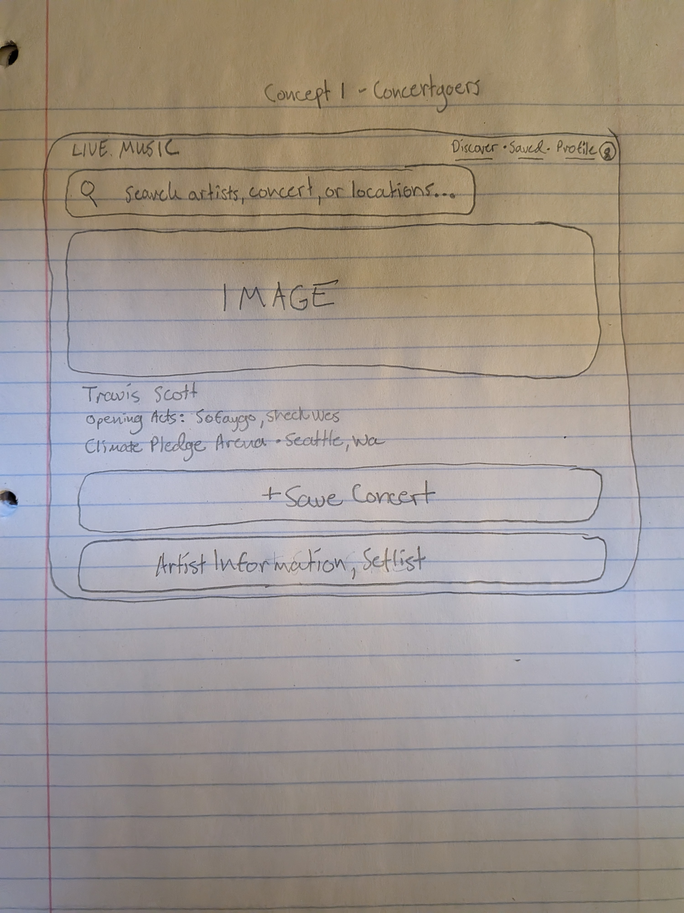
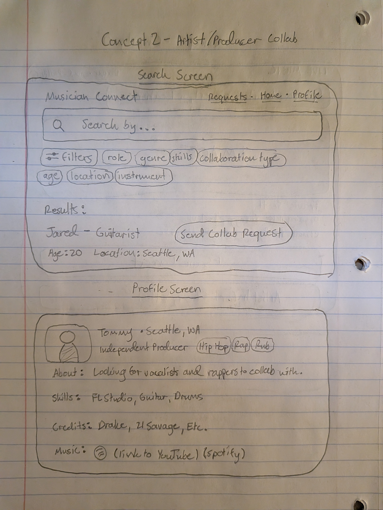
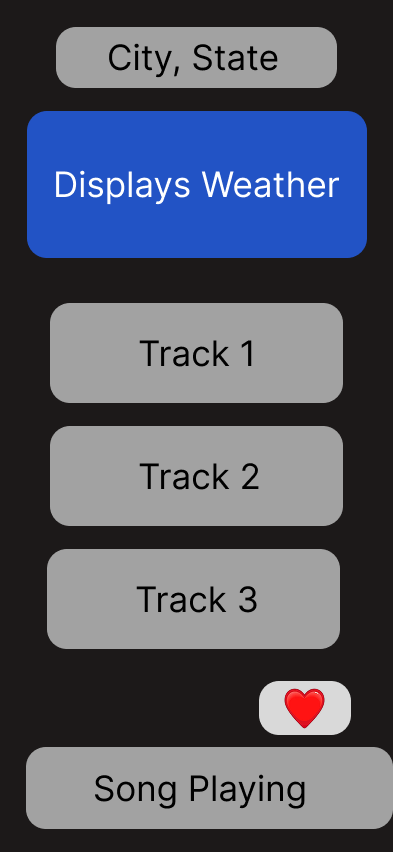

*** Concept 1 - Live Music: Concert Discovery and Helper ***

1. What it is

This would be a platform that helps concertgoers discover upcoming live music events, explore artists performing at those events, and access concert information before and afterward. Users could search for concerts by location, date, and artist, save intruiging events, view information such as openers and venue location, and also access setlists and information once the show is done. 

2. Who it's for

The target audience would be for college students  and young adults who enjoy attending live music events, especially people interested in discovering new artists and going to shows. However, anyone would be welcome to use it. Our system would be designed to have more information in one place, because many people currently have to visit multiple websites to find concerts, research performers, and find relevant information about the show. 

3. What value it adds

Rather than simply displaying a list of upcoming concerts (which many websites aleady do), this application would connect information about events, artists, venues, and songs performed. 

For example, someone going to a concert might not recognize the opening artist and could learn more about that artist from our app which would provide information about that artist. Another example is someone going to a concert that doen't know the songs by name and might want to see the setlist afterwards. Other possible information we could add is crowd size, monthly listener count, and transit options. 

4. Data Sources

There are a few we could use - if we choose this project we'll narrow it down. A few good ones could be:

Ticketmaster Discovery API - Could be used to find upcoming concerts, dates, and venues
Setlist.fm API - Could be used to gather setlists from concerts
Spotify API - Could be used for monthly listeners stats, and most popular songs
MusicBrainz API - Could be used for artist information

5. Depth Item

Many Lenses

The application would combine multiple sources of information to give users a more immersive concert experience. Instead of making users visit separate websites to find events and look up performances, our application brings event details and setlists together in one place. As mentioned above this would be upcoming concerts, artist information, venues, and setlists etc.

6. Sketch 

7. Initial user flow

- Open app
    - User visits the concert discovery homepage
- Search for concerts
    - Enter an artist, location, or date
- View results
    - Python retrieves event information from Ticketmaster
- Select a concert
    - View performers, venue, and event details
- Save concert
    - Concert is saved to the user's saved events in JSON
- Return after the concert
    - View setlist
- Explore setlist
    - User views songs performed and discovers music

8. Empty, loading, and error states

Empty

No concerts match the search. A message would appear "No concerts found." If a setlist isn't available yet, a message would appear "Not yet submitted."

Loading

Display a loading indicator when searching for concerts and message "Finding concerts near you..." or "Finding artist information" when looking at artist information.

Error

If Ticketmaster or Setlist.fm are having trouble or are unavailable, we would display a helpful message: "We couldn't retrieve concert information. Please try again." 

9. AI Note

AI would be useful in helping generate artist summaries and organizing music information but unreliable when identifying actual setlists or providing accurate event details without verified API data. 

*** Concept 2 - Music Collaboration Platform ***

1. What it is

A web application that connects that connects independent musicians with potential collaborators. Users can create profiles showcasing their music, skills, and credits. They can discover other creators, browse collaboration opportunities, and send collaboration requests. 

2. Target audience

Our target audience would be independent artists and upcoming musicians. This would include music producers, vocalists, and instrumentalists. Specifically we would be targeting college students and young creators interested in making music. 

3. What value it adds

Finding musica collaborators can be difficult, especially for people that don't have established industry connections. This platform would make it easier to discover people with similar musical interests or match people with needs. For example a producer might be looking for a guitar player to add a layer onto one of their beats. Or maybe a rapper is looking for a vocalist to record on the intro of their song. 

4. Data Sources

Youtube Data API - This would allow musicians to showcase their music on our platform. 

MusicBrainz API - Retrieve artist information, including genres and metadata to help organize creator profiles and music discovery. 

5. Depth Item 

Multiplayer

The application allows multiple musicians to create profiles, discover potential collaborators, and send collaboration requests. 

6. Sketch

7. Initial user flow

- Create a Profile
    - User selects their role, genres, skills, and musical influences
- Discover creators
    - Browse and filter creators by genre, role, instruments played, style
- Explore a profile
    - Listen to sample tracks and learn about another musician
- Send a collaboration request
    - User explains what kind of project they'd like to work on (song, beat, loop)
- Manage collaborations
    - View received requests and save potential collaborators

8. Empty, loading, and error states

Empty

If no creators match the selected filters we would display a message like "No creators found. Please broaden your search!"

Loading

Display a loading icon and a message like "Finding collaborators"

Error

If the app is experiencing a technical difficulty we could display a message saying "We couldn't load creator profiles. Please try again."

9. AI could help recommend potential collaborators based on musical styles, interests, and genres, but it could make innacurate assumptions about someone's sound without being able to fully analyze the music. Also I think it is important to note that one thing we would be heavily against with this platform is generative AI music and AI creators.

*** Concept 3 - Weather Mood Playlist ***

1. What it is

This app would give music suggestions on the current weather depending on the time of day in the users city. The user would enter a city (or an autodetector would track the users locaation) and the app would should the conditions of the weather. It would then build a playlist that fits the mood. Users can adjust the mood mapping so that specific weather tends to play a specific genre of music which can be saved in their weather playlist.

2. Who it's for

This app would be used for college students or anyone to be honest, as it would be useful for people who listen to music while commuting, studying, or walking around campus or to work. This is mean't for users who want music that sets the music based on their weathre or wantss to be tapped into new music that fits the mood without having to physically search music by hand.

3. What value it adds

Weather apps would show the confitions in the city and musics app shows songs, but there is nothing that connects the two. THis app would combine real-time weather depending on the time of day with music taste and genre that the user enjoys. It would also remember the music that the user likes so that suggestions get more pesonal over tume rather than being more of a general playlist based on the weather. 

4. Data Sources

Data Sources
Open-Meteo API: current weather, temperature, and conditions (no key needed)

Last.fm API: top tracks and artists by tag (like “chill,” “upbeat,” “rainy day”)

YouTube Data API (optional): link or embed a track so the user can listen right away

5. Depth Item

Many Lenses

The app combines several sources on one thing, the user’s moment: weather, time of day, and the music that fits. The design question is how to show them together, for example a weather card at the top with a mood label and a track list below.

6. Sketch 

7. Initial user flow

- Open app
    User sees a city search box and a “use my location” option
- Choose a place
    Enter a city or allow location
- View weather and mood
    Python gets conditions from Open-Meteo and maps them to a mood (rain + evening = mellow)
- See suggested tracks
    Python gets tracks from Last.fm using matching tags
- Adjust or save
    User changes the mood, or saves the playlist to their saved moods in JSON
- Return later
    Saved moods and favorite weather pairings are loaded from JSON

8. Empty, loading, and error states

Empty

If no tracks come back for a mood, show “No tracks found for this mood. Try a different one!” If the user has no saved playlists yet, show “Nothing saved yet. Save a playlist you like!”

Loading

Show a loading indicator with “Checking the weather...” and then “Finding music for the mood...”

Error

If Open-Meteo or Last.fm is unavailable, show “We couldn’t load the weather or music. Please try again.” If the city isn’t found, show “We couldn’t find that city. Check the spelling and try again.”

9. AI Note

AI would be good at suggesting how weather conditions map to moods and genres, but bad at knowing which specific songs exist or what people actually enjoy. Those need to come from real API data.