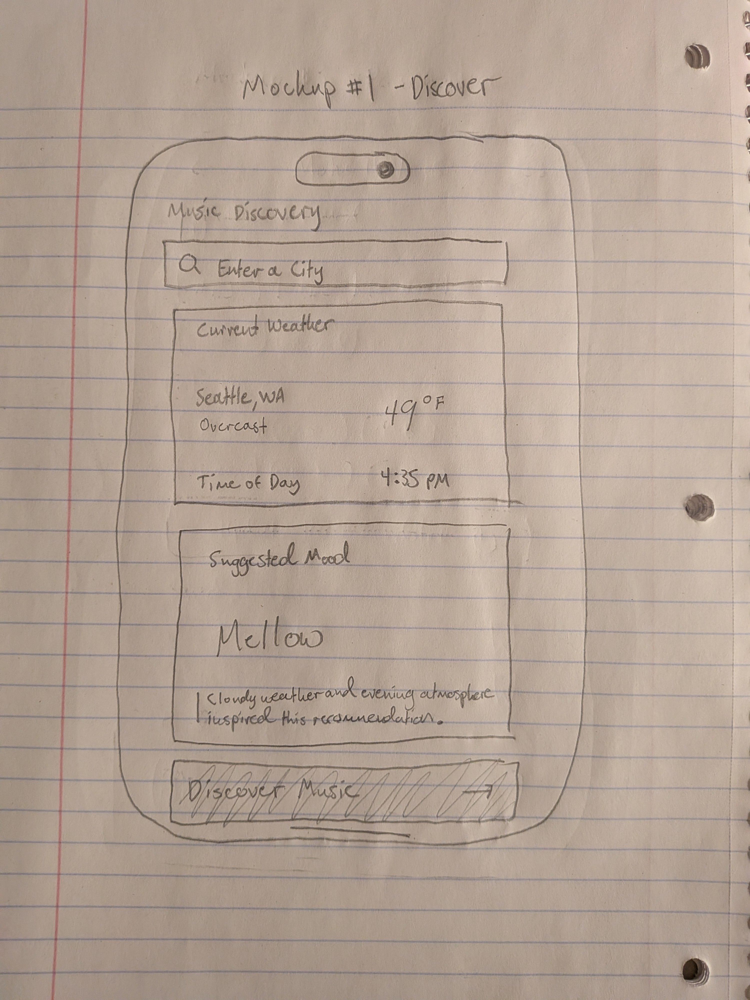
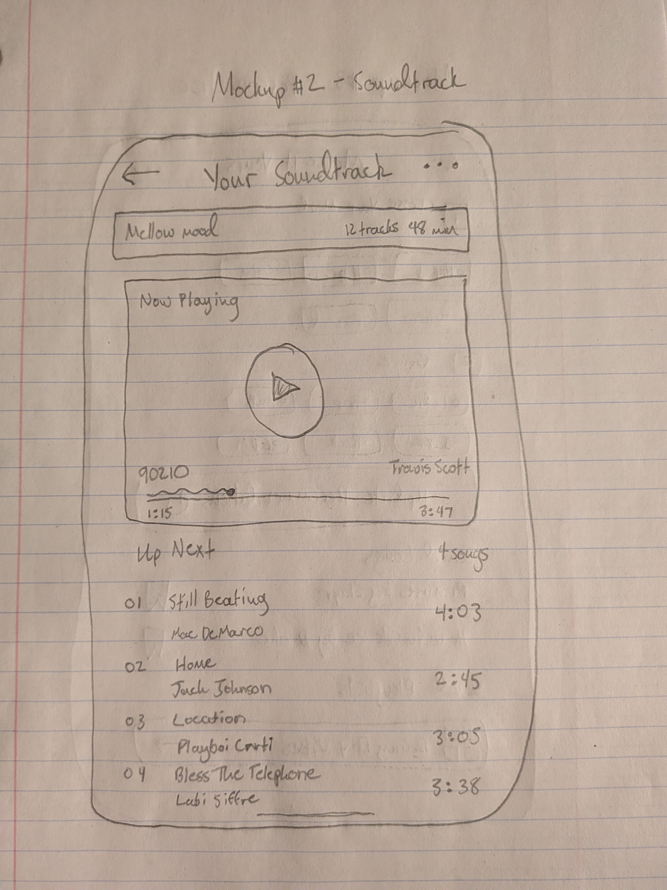
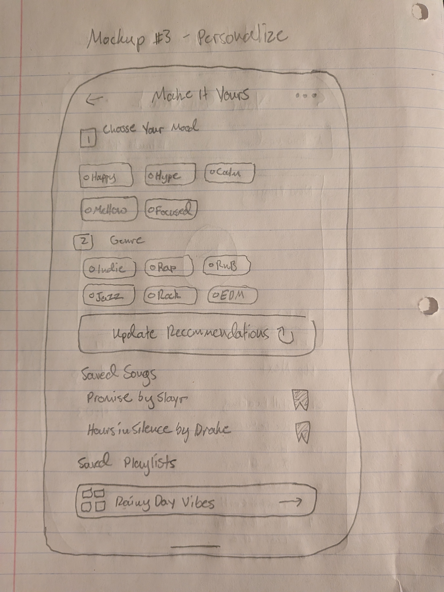

P2: Proposal  
Jayden Low, Reid Schmidt  
November, 2026  
---

**Design problem, audience, and value**

College students who listen to music throughout the day often want to find songs that match their current mood or environment but don’t always know what to search for. Our app will be designed for students who listen to music while walking around campus, commuting, studying, or relaxing and want to discover music that fits their surroundings. By combining real time weather conditions and time of day, the app generates a mood and recommends songs and genres that match that atmosphere. Unlike traditional music platforms, our app connects the user’s current environment with music discovery, helping students find new music without having to manually search through genres or playlists. 

**Depth Item \- Many Lenses**

Our app uses many lenses by combining weather, time of day, and user preferences to recommend music that matches a student’s current environment and mood. The new piece needed is a Python recommendation system that processes these inputs, determines a suggested mood, and finds matching songs through the Last.fm API. We will measure success by whether at least two out of three testers can explain how the weather and time of day influenced their recommendations. 

**Main User Flow**

| The User | The App | They See |
| :---- | :---- | :---- |
| Enters location | Retrieves weather report from there | Weather report in that location |
| Enters music taste and favorite artists | Remembers this data | More recommendations and music from data retrieved |
| Clicks favorite on song | Remembers this data | A heart next to the song and more music like it |

**Data Sources**

### **Data Source 1: Open-Meteo Weather API**

**Documentation link:** [Open-Meteo Weather API](https://open-meteo.com/en/docs)

**What we use it for:** We use Open-Meteo in Action 1 (Get Weather and Generate a Mood) to retrieve current weather conditions for the user's selected location. Our app uses the temperature, precipitation, and weather conditions to help determine a suggested music mood.

**Key or limits:** Open-Meteo does not require an API key for free non-commercial use. Its free service allows up to 10,000 API calls per day.

**The call:** We use the Open-Meteo forecast endpoint with Seattle's latitude (47.6062) and longitude (-122.3321). We request the current temperature, precipitation, weather code, and day/night information.

```
import json
import ssl
import certifi
from urllib.request import urlopen
from urllib.parse import urlencode

params = {
    "latitude": 47.6062,
    "longitude": -122.3321,
    "current": "temperature_2m,precipitation,weather_code,is_day",
    "temperature_unit": "fahrenheit"
}

url = "https://api.open-meteo.com/v1/forecast?" + urlencode(params)
context = ssl.create_default_context(cafile=certifi.where())

with urlopen(url, context=context, timeout=20) as response:
    data = json.loads(response.read().decode("utf-8"))

print(json.dumps(data["current"], indent=4))
```

**One real response:** This is the actual output from running our request for Seattle:

```
{
    "time": "2026-11-19T21:15",
    "interval": 900,
    "temperature_2m": 49.6,
    "precipitation": 0.0,
    "weather_code": 3,
    "is_day": 1
}
```

**What we noticed or were surprised by:** The API returns numerical weather codes instead of written descriptions. For example, our response returned weather code 3, which represents overcast conditions. We will need Python logic to translate these codes into readable weather conditions before using them to generate music recommendations.

**Data Source 2 \- iTunes Search API**

**Documentation link: [iTunes Search API: Overview](https://developer.apple.com/library/archive/documentation/AudioVideo/Conceptual/iTuneSearchAPI/index.html)**  

**What we use it for:** We use iTunes in Action 2: Discover and Play Music. After our Python code generates a mood, the app searches for songs using terms related to that mood and the user’s preferred genre. It returns song titles, artist names, and other information that we can use when searching YouTube for playable versions. 

**Key or Limits:** No API key or account is required. Apple’s documentation states that the API supports approximately 20 requests per minute, although this limit can change. Search requests can return up to 200 results, but we will request only 10\. Apple restricts the use of promotional content, including previews and artwork, to promoting content in its stores. 

**The call:** We use the iTunes Search endpoint with the search term `chill indie`, the song entity, and a limit of 10 results in the US catalog.

```
https://itunes.apple.com/search?term=chill+indie&media=music&entity=song&limit=10&country=US
```

**One real response:** Our actual request returned 8 results. Here are three examples from the response:

```json
[
  {
    "trackName": "we fell in love in october",
    "artistName": "girl in red",
    "collectionName": "we fell in love in october / forget her - Single",
    "primaryGenreName": "Alternative"
  },
  {
    "trackName": "Self Control",
    "artistName": "Frank Ocean",
    "collectionName": "Blonde",
    "primaryGenreName": "Pop"
  },
  {
    "trackName": "Get You (feat. Kali Uchis)",
    "artistName": "Daniel Caesar",
    "collectionName": "Freudian",
    "primaryGenreName": "R&B/Soul"
  }
]
```

**What we noticed or were surprised by:** Our search for "chill indie" returned songs from several different genres, including Alternative, Pop, and R\&B/Soul. This shows that the API uses broad text-based search rather than strict mood categories. We will need to review the results and use the user's selected genre or other filters to make recommendations more relevant.

### **Data Source 3: YouTube Data API v3**

**Name and documentation link:**  
[YouTube Data API v3 – Search: list](https://developers.google.com/youtube/v3/docs/search/list)

**What we use it for:**  
We use the YouTube Data API in Action 2, when users discover and play recommended music. After the iTunes Search API finds songs that match the user's suggested mood, our app searches YouTube for videos of those songs. We use the returned video IDs to embed YouTube players directly in our app.

**Key or limits:**  
This API requires a Google Cloud API key, which we store in our `.env` file rather than exposing in our code. The default quota allows 100 `search.list` requests per day, with each search costing 1 quota unit. We can reduce unnecessary requests by caching search results. We also use `videoEmbeddable=true` to filter for videos that can be embedded in our app.

**The call:**  
We make a GET request to:

`https://www.googleapis.com/youtube/v3/search`

Our test uses these parameters:

* `part=snippet`  
* `q=girl in red we fell in love in october`  
* `type=video`  
* `videoEmbeddable=true`  
* `maxResults=5`  
* `key=our API key`

The request is implemented in `P2/youtube_test.py`.

**One real response:**  
Our test successfully returned 5 results. Here are three examples from the actual response:

```
{
    'title': 'girl in red - we fell in love in october',
    'channel': 'girl in red',
    'video_id': 'iggmiF7DNoM',
    'embed_url': 'https://www.youtube.com/embed/iggmiF7DNoM'
}

{
    'title': 'girl in red - we fell in love in october (Lyrics)',
    'channel': 'Dan Music',
    'video_id': 'AmTMNntVmbQ',
    'embed_url': 'https://www.youtube.com/embed/AmTMNntVmbQ'
}

{
    'title': 'girl in red | We fell in love in october (Sub. Español)',
    'channel': 'Ángel DM',
    'video_id': '7T7-cqhRvIc',
    'embed_url': 'https://www.youtube.com/embed/7T7-cqhRvIc'
}
```

**What we noticed or were surprised by:**  
We noticed that YouTube returned multiple versions of the same song, including the original artist's upload, lyric videos, and translated versions. This means we will need to prioritize relevant results, such as videos uploaded by the original artist when possible. We also learned that the API returns video IDs and metadata rather than audio files, so our app will use YouTube's embedded player to play the selected song.

**Data Model**

| Noun | What it Holds |
| :---- | :---- |
| User | User ID, location, music preferences |
| Location | City name |
| Weather | Weather conditions, temperature |
| Song | Song ID, title, artist, genre |
| Playlist | Playlist ID, playlist name, list of songs, weather condition |
| Favorites | Playlist ID, user’s saved songs |

**Tech Plan**

| Route | Receives | Calls | Shows |
| :---- | :---- | :---- | :---- |
| / | Nothing | Nothing | Homepage with a location input, music preferences, and a button to generate a playlist.  |
| /generate | User's location and music preferences (such as genre or mood)  | Weather API and music API  | Current weather conditions and a playlist of songs selected to match the weather and preferences.  |
| /save | Playlist information (playlist name and selected songs)  | No outside API; saves data to playlists.json | Confirmation that the playlist was saved.  |
| /saved | Nothing  | Reads playlists.json  | A list of the user's previously saved playlists.  |
| /delete | Playlist ID  | Updates playlists.json | Updated saved-playlist list after the selected playlist is removed.  |

| File | What it Does |
| :---- | :---- |
| app.py | Runs the Flask application and handles the routes, user input, and page navigation.  |
| weather.py | Calls the weather API, retrieves weather information, and extracts the fields the app needs, such as temperature and weather conditions.  |
| music.py | Calls the music API to retrieve song information, such as titles, artists, and genres.  |
| playlist.py | Uses the weather information and music preferences to determine which songs best match the user's conditions and creates a playlist.  |
| storage.py | Saves, retrieves, and deletes playlists from the JSON file.  |
| playlists.json | Stores the user's saved playlists so they remain available between visits.  |
| templates/dinex.html | Displays the homepage, location input, music preferences, and playlist-generation button.  |
| templates/playlist.html | Displays the weather information and the generated playlist.  |
| templates/saved.html | Displays the user's saved playlists.  |
| static/style.css | Controls the visual design, layout, colors, and styling of the app.  |

**Who We’ll Test With**

| Tester | Role/Description | How We’ll Reach Them | Planned Testing Date |
| :---- | :---- | :---- | :---- |
| Tester 1 | Average UW student who listens to music daily to class | Someone we know | TBD |
| Tester 2 | UW student who listens to music while doing sports activities | Someone we know | TBD |
| Tester 3 | UW student who listens to music while doing sports activities | Someone we know | TBD |

**Success Criteria**  
We will measure the success of our weather-based music playlist app through both technical functionality and user testing.  
Code Success Criteria  
1\. Weather and music API integration: The app successfully retrieves weather information and music data from both APIs and combines them to generate a playlist based on the user's current weather and selected music preferences.

2\. Playlist saving: Users can save generated playlists, and the saved playlists remain accessible after closing and reopening the app through persistent JSON storage.

3\. Error handling: If a user enters an invalid location or one of the APIs fails to respond, the app displays a clear error message instead of crashing.  
People Success Criteria  
1\. At least 2 out of 3 testers can enter their location, select their music preferences, and generate a playlist without assistance.

2\. At least 2 out of 3 testers feel that the generated songs match the weather conditions and their selected music preferences.

3\. At least 2 out of 3 testers can successfully save a playlist and find it again when revisiting the saved playlists page.

**Priorities and Risk**

* Retrieving actual API’s that are both easy to retrieve and validate our project  
* Retrieve music information using a music API  
* Handle errors such as invalid locations, API failures, or missing information without crashing  
* This is just a possible add on, but being able to curate music based on the weather but also by the user’s mood, because it could be a sunny day but the user is going through a break up, so happy and upbeat music might not be appropriate

**AI Plan**

We will write the main design decisions and project logic ourselves, including the problem statement, target audience, user flow, data model, success criteria, and Python function that maps weather and time of day to a suggested mood. We may use AI to help understand API documentation, refine our low-fidelity mockups, debug technical issues, and check our proposal for missing requirements. We will test any AI suggestions by running our code with real API responses, checking different weather conditions, and comparing the results with our success criteria and feedback from our three user testers. We will not hand off the core weather-to-mood recommendation logic or our design decisions to AI because these are central to our concept and should reflect our own understanding of what UW students would find useful.

### **11\. Pairs**

Reid will be responsible for the Python backend, including the Open-Meteo, iTunes Search, and YouTube API integrations, the weather-to-mood recommendation logic, and saving user preferences and playlists as JSON data. Jayden will be responsible for the frontend and user interface, including the page layouts, styling, low-fidelity mockups, and implementing the main user interactions. We will work together on the overall design, user testing, success criteria, and final integration to make sure the frontend and backend work together correctly. We will communicate regularly and coordinate file changes to avoid editing the same files at the same time.

*** Mockups ***





