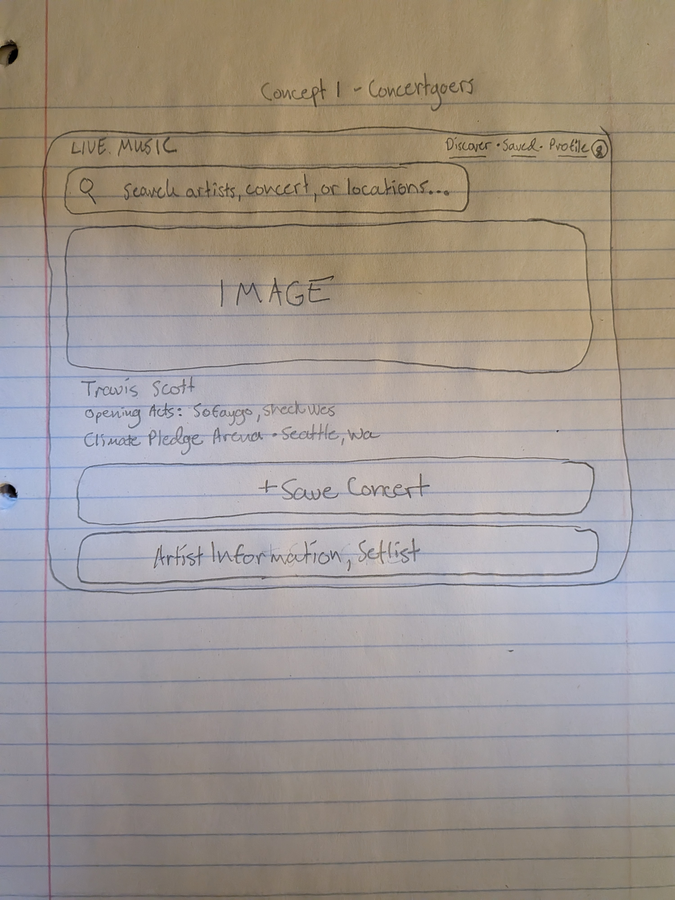

*** Concept 1 - Live Music: Concert Discovery and Helper ***

1. What it is

This would be a platform that helps concertgoers discover upcoming live music events, explore artists performing at those events, and access concert information before and afterward. Users could search for concerts by location, date, and artist, save intruiging events, view information such as openers and venue location, and also access setlists and information once the show is done. 

2. Who it's for

The target audience would be for college students  and young adults who enjoy attending live music events, especially people interested in discovering new artists and going to shows. However, anyone would be welcome to use it. Our system would be designed to have more information in one place, because many people currently have to visit multiple websites to find concerts, research performers, and find relevant information about the show. 

3. What value it adds

Rather than simply displaying a list of upcoming concerts (which many websites aleady do), this application would connect information about events, artists, venues, and songs performed. 

For example, someone going to a concert might not recognize the opening artist and could learn more about that artist from our app which would provide information about that artist. Another example is someone going to a concert that doen't know the songs by name and might want to see the setlist afterwards. Other possible information we could add is crowd size, monthly listener count, and transit options. 

4. Data Sources

There are a few we could use - if we choose this project we'll narrow it down. A few good ones could be:

Ticketmaster Discovery API - Could be used to find upcoming concerts, dates, and venues
Setlist.fm API - Could be used to gather setlists from concerts
Spotify API - Could be used for monthly listeners stats, and most popular songs
MusicBrainz API - Could be used for artist information

5. Depth Item

Many Lenses

The application would combine multiple sources of information to give users a more immersive concert experience. Instead of making users visit separate websites to find events and look up performances, our application brings event details and setlists together in one place. As mentioned above this would be upcoming concerts, artist information, venues, and setlists etc.

6. Sketch 

7. Initial user flow

- Open app
    - User visits the concert discovery homepage
- Search for concerts
    - Enter an artist, location, or date
- View results
    - Python retrieves event information from Ticketmaster
- Select a concert
    - View performers, venue, and event details
- Save concert
    - Concert is saved to the user's saved events in JSON
- Return after the concert
    - View setlist
- Explore setlist
    - User views songs performed and discovers music

8. Empty, loading, and error states

Empty

No concerts match the search. A message would appear "No concerts found." If a setlist isn't available yet, a message would appear "Not yet submitted."

Loading

Display a loading indicator when searching for concerts and message "Finding concerts near you..." or "Finding artist information" when looking at artist information.

Error

If Ticketmaster or Setlist.fm are having trouble or are unavailable, we would display a helpful message: "We couldn't retrieve concert information. Please try again." 

9. AI Note

AI would be useful in helping generate artist summaries and organizing music information but unreliable when identifying actual setlists or providing accurate event details without verified API data. 